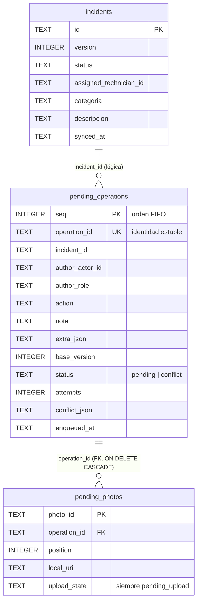

# Modelo de datos local — CampusOps (semana 8)

Responsable: persistencia, cola persistente y migración (pasos 1, 2 y 3 de la actividad).
Todos los datos son ficticios y salen del contrato público (`campus-inc-001`, `technician-1`, `technician-2`, `coordinator-1`).

## 1. Almacenamiento elegido

| Aspecto | Decisión |
|---|---|
| Motor | **SQLite** mediante `expo-sqlite` (~57.0.4), archivo `campusops.db` en el almacenamiento privado de la app. |
| Acceso | Puerto `SqlDatabase` (`src/infrastructure/persistence/SqlDatabase.ts`). Adaptador de la app: `ExpoSqliteDatabase` (usa `withExclusiveTransactionAsync`). Adaptador de pruebas: `NodeSqliteDatabase` (mismo motor SQLite de Node, `node:sqlite`, sobre un archivo real en disco). |
| Versión de esquema | `PRAGMA user_version` del propio archivo. Versión actual: **2** (`LATEST_SCHEMA_VERSION`). |
| Apertura | `openDeviceOfflineStore()` → `openOfflineStore(db)`: activa `PRAGMA foreign_keys = ON`, migra y sólo entonces entrega la cola y la caché. Se llama en el composition root (`App.tsx`). |

**Alternativa descartada:** almacenamiento clave-valor (AsyncStorage/SecureStore) con escritura en dos fases (escribir la versión nueva y luego cambiar un puntero). Funciona, pero hay que programar a mano el rollback, la limpieza de copias a medias y el orden de la cola; SQLite ya da transacciones atómicas que incluyen DDL y `user_version`. `expo-secure-store` se mantiene **sólo** para el token de refresco (semana 6): no está pensado para volúmenes de datos.

## 2. Entidades y relaciones (esquema v2)



- **`incidents`** (puerto `LocalIncidentCache`, `SqliteIncidentCache`): última copia **confirmada por el servidor** de cada incidencia visible. Sirve para consultar sin conexión y para autorizar localmente con `canPerform` (misma regla de la semana 6). Nunca se modifica con cambios locales no confirmados: esos viven en la cola.
- **`pending_operations`** (puerto `PendingOperationQueue`, `SqlitePendingOperationQueue`): un cambio hecho por un actor que todavía no confirma el servidor.
- **`pending_photos`**: referencias a fotografías que siguen en el dispositivo. `upload_state` tiene un `CHECK (upload_state = 'pending_upload')`: la base **no puede** representar una foto como "ya subida". Al confirmar la operación se borran en cascada.
- La relación `incidents` → `pending_operations` es lógica (sin FK) a propósito: refrescar la caché con datos del servidor no debe borrar ni bloquear intenciones locales.

## 3. Estructura de la cola persistente

Tipo de dominio: `PendingOperation` en `src/domain/sync/PendingOperation.ts`.

| Campo | Columna | Significado |
|---|---|---|
| `operationId` | `operation_id` (UNIQUE) | Identidad estable. Se genera una vez al registrar el cambio; viaja como `Idempotency-Key`. No cambia al reintentar ni al reiniciar. |
| `incidentId` | `incident_id` | Incidencia afectada. |
| `author` | `author_actor_id`, `author_role` | Actor que hizo el cambio (p. ej. `technician-1` / `technician`). |
| `content` | `action`, `note`, `extra_json`, filas de `pending_photos` | Acción (`start`, `resolve`, …), nota, datos extra (p. ej. `diagnosis`) y referencias de fotos pendientes. |
| `baseVersion` | `base_version` | Versión de la incidencia (según la caché) sobre la que se hizo el cambio. |
| `status` | `status` | `pending` o `conflict`. Un conflicto **sigue en la cola**. |
| `attempts` | `attempts` | Intentos de envío registrados. |
| `conflict` | `conflict_json` | Campos incompatibles, versión remota y momento de detección. |
| `enqueuedAt` | `enqueued_at` | Momento de registro (ISO 8601). |

Reglas implementadas:

1. `enqueue` es atómico: la operación y sus fotos se escriben en una transacción (prueba `an operation and its photo references are written atomically`).
2. Repetir un `operationId` con el mismo contenido devuelve la operación ya guardada; reutilizarlo con otro contenido lanza `OperationIdentityError` (prueba `re-enqueuing the same operationId keeps the first operation…`).
3. `list()` devuelve en orden de llegada (`seq`).
4. `removeConfirmed` es la única forma de sacar una operación de la cola y sólo se llama tras confirmación del servidor. `markConflict` **no** la retira.
5. El caso de uso `recordOfflineIncidentWork` (`src/application/offline/`) autoriza con `canPerform` contra la caché antes de encolar: un técnico no asignado o una acción de coordinación se rechazan con `ForbiddenActionError` y no se escribe nada. El servidor vuelve a autorizar al sincronizar.

## 4. Esquema anterior (v1)

```sql
incidents(id PK, version, work_json, detalle_json, synced_at)
outbox(operation_id PK, incident_id, actor_id, actor_role, base_version, body_json, created_at)
```

`work_json` = `{ status, assignedTechnicianId }`; `body_json` = `{ action, note, photoUris[], extra }`. Las fotos eran URIs sueltas dentro del JSON, sin estado ni identidad.

## 5. Procedimiento de migración v1 → v2

`migrateToLatest` en `src/infrastructure/persistence/schema.ts`. Todo ocurre en **una sola transacción**:

| Paso (`MigrationStep`) | Acción |
|---|---|
| `create_v2_tables` | Crea `incidents_v2`, `pending_operations_v2`, `pending_photos_v2`. |
| `copy_incidents` | Separa `work_json` en `status` y `assigned_technician_id`; `detalle_json` en `categoria` y `descripcion`. |
| `copy_operations` | Copia `outbox` en orden de `rowid` (conserva FIFO) con `status = 'pending'`, `attempts = 0`. |
| `copy_photos` | Cada URI se vuelve una fila `pending_upload` con `photo_id = <operation_id>#photo-<n>` (determinista: repetir la migración da los mismos IDs). |
| `drop_v1_tables` | Borra `outbox` e `incidents` antiguas. |
| `rename_v2_tables` | Renombra `*_v2` a su nombre final; SQLite reescribe la FK de `pending_photos`. Crea índices. |
| `set_version` | `PRAGMA user_version = 2`. |

Instalación nueva (`user_version = 0`): crea directamente el esquema v2. Versión desconocida (> 2): se rechaza con `MigrationFailedError` sin tocar datos.

### Falla y recuperación

- `migrateToLatest(db, { beforeStep })` expone un punto de inyección de fallas antes de cada paso (sólo lo usan las pruebas).
- Si cualquier paso lanza, la transacción hace `ROLLBACK`: SQLite revierte DDL, filas y `user_version`. Se lanza `MigrationFailedError { fromVersion, step }`.
- `openOfflineStore` cierra la conexión y no entrega una cola a medias; la app muestra "Datos locales: unavailable" y registra `offline_store.open_failed` en telemetría sanitizada.
- **Recuperación controlada:** el siguiente arranque vuelve a ejecutar la misma migración desde el v1 intacto.

Estados observados (prueba `records the state before, after the injected failure and after recovering on the next start`, falla inyectada en `copy_photos`, es decir, con tablas nuevas ya creadas e incidencias y operaciones ya copiadas):

| Momento | `user_version` | Tablas | Filas |
|---|---|---|---|
| Antes | 1 | `incidents`, `outbox` | 2 incidencias, 2 operaciones |
| Después de la falla (archivo reabierto) | 1 | `incidents`, `outbox` | 2 incidencias, 2 operaciones (idéntico a "antes", sin tablas `*_v2`) |
| Después de recuperar (segundo arranque) | 2 | `incidents`, `pending_operations`, `pending_photos` | 2 incidencias, 2 operaciones, 1 foto `pending_upload` |

La prueba parametrizada `a failure injected before %s rolls back to the intact v1 schema` repite la falla en los siete pasos y compara el estado completo (versión, tablas y todas las filas) con el estado anterior.

## 6. Cómo reproducir

```bash
npx jest --ci src/infrastructure/persistence
# guardar los tres estados de la migración fallida/recuperada:
WEEK08_STATE_LOG=reports/week-08/migration-states.json npx jest --ci src/infrastructure/persistence -t "records the state"
```

Las pruebas crean archivos SQLite temporales, cierran la conexión y abren una nueva sobre el mismo archivo para simular el reinicio de la app.
